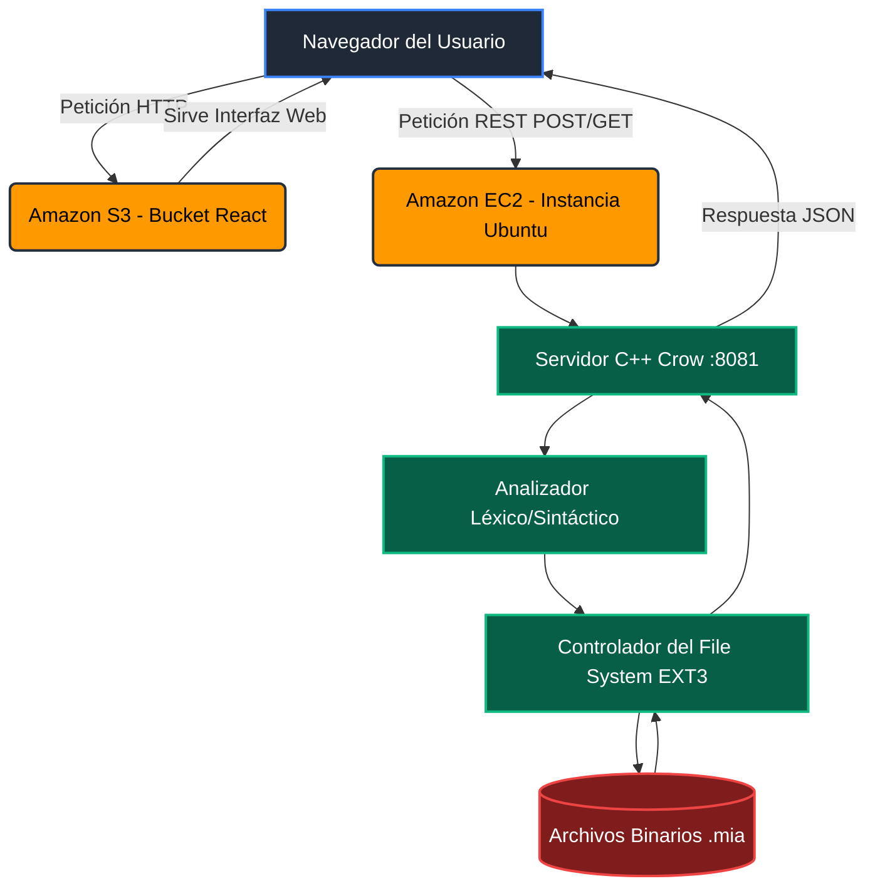

# Manual Técnico: Sistema de Archivos EXT3 y Aplicación Web

**Proyecto 2 - Manejo e Implementación de Archivos**
**Carnet:** 202400044
**Desarrollador:** Pablo Daniel Solares Samayoa

---

## 1. Descripción de la Arquitectura del Sistema y Despliegue en AWS

El sistema "C++Disk" opera bajo una arquitectura distribuida de modelo **Cliente-Servidor**, donde la interfaz gráfica y el motor lógico están completamente desacoplados. Para esta fase, el sistema ha sido migrado a la infraestructura en la nube de **Amazon Web Services (AWS)**.

### Arquitectura de la Aplicación

* **Frontend (Cliente estático):** Desarrollado en React y estilizado con TailwindCSS. Actúa como la interfaz de usuario que captura los scripts en formato `.smia` o comandos individuales en la terminal web.
* **Backend (Motor Lógico):** Escrito en C++17 utilizando el framework web **Crow**. Expone una API REST (puerto 8081) que recibe instrucciones JSON, ejecuta las operaciones binarias sobre los discos físicos y devuelve los resultados y reportes al cliente.

### Arquitectura de Despliegue en AWS

* **Amazon S3 (Simple Storage Service):** Actúa como el host del Frontend. El build de producción de React se almacena en un bucket público configurado para *Static Website Hosting*, sirviendo la interfaz de forma rápida y sin necesidad de un servidor web tradicional.
* **Amazon EC2 (Elastic Compute Cloud):** Es el servidor Linux (Ubuntu) donde reside y se ejecuta el backend en C++. Dentro del almacenamiento físico de esta instancia EC2 (en la ruta `/home/pablo/`) es donde se crean, leen y modifican los archivos binarios `.mia`.
* **Security Groups:** Capa de seguridad de AWS configurada para permitir el tráfico HTTP de entrada (hacia el puerto del backend) y la conexión SSH para la administración remota de la instancia.

### Diagrama de Integración

---

## 2. Explicación de las Estructuras de Datos

El sistema modela un disco duro real utilizando estructuras (`structs`) serializables en C++ con tamaños fijos, garantizando el direccionamiento exacto de bytes.

### Estructuras de Particionamiento
* **MBR (Master Boot Record):** Se ubica en el byte 0 del archivo `.mia`. Administra el tamaño total, la firma del disco y un arreglo fijo de 4 registros para particiones primarias o extendidas.
* **EBR (Extended Boot Record):** Estructura enlazada que se guarda al inicio de cada partición lógica. Contiene un puntero hacia el siguiente EBR, permitiendo crear múltiples particiones lógicas dentro de una sola partición extendida.

### Estructuras del Sistema de Archivos
* **Superbloque:** Es la cabecera del sistema de archivos. Mantiene el control total sobre los inodos y bloques libres/ocupados, los contadores totales y los índices de inicio de los Bitmaps. Determina si el sistema es EXT2 o EXT3 (este último activa el Journaling).
* **Inodo:** La estructura central de información. No guarda datos directamente, sino metadatos: fechas, tamaño, permisos (en base octal), propietario (UID) y grupo (GID). Posee 15 punteros (12 directos y 3 indirectos) que apuntan a la ubicación física de los bloques de datos.
* **Journal (Bitácora - Exclusivo de EXT3):** Un bloque especial de memoria que registra toda transacción destructiva o de creación (crear carpetas, eliminar archivos, dar permisos) antes de que se ejecute. Su propósito es permitir la recuperación del sistema en caso de pérdida de datos.

### Estructuras de Bloques (64 bytes cada uno)
* **Bloque de Carpeta:** Organiza la jerarquía. Contiene 4 espacios lógicos. Cada espacio guarda el nombre de un archivo/carpeta (máximo 11 caracteres más el terminador nulo `\0`) y un puntero hacia el inodo de ese elemento.
* **Bloque de Archivos:** Contiene un arreglo de 64 caracteres de texto plano. Si un archivo pesa más de 64 bytes, el inodo apuntará a múltiples bloques de archivo.
* **Bloque de Apuntadores:** Un arreglo de 16 números enteros. Funciona como un "puente" cuando un inodo supera sus 12 punteros directos, permitiendo apuntar a más bloques de información.

---

## 3. Descripción de los Comandos Implementados

A continuación, se detalla el conjunto de instrucciones de la Fase 2, diseñadas para manipular la jerarquía, los usuarios y el estado del sistema de archivos EXT3.

### Gestión de Usuarios y Permisos
Modifican el inodo del archivo `users.txt` o los metadatos de un inodo específico.
* **MKGRP / RMGRP:** Crea o elimina un grupo lógico en el sistema.
  * **Parámetros:** `-name`
  * **Efecto Interno:** Lee el inodo de `users.txt`, extrae sus bloques, agrega la nueva línea del grupo (o cambia su estado a `0` para eliminación lógica) y reescribe los bloques en el disco.
* **MKUSR / RMUSR / CHGRP:** Crea usuarios, los elimina o los cambia de grupo.
  * **Parámetros:** `-user`, `-pass`, `-grp`
  * **Efecto Interno:** Valida la existencia del grupo y la unicidad del usuario antes de añadir o dar de baja el registro en `users.txt`.
* **CHMOD:** Modifica los permisos de lectura, escritura y ejecución.
  * **Parámetros:** `-path`, `-ugo` (número octal de 3 dígitos, ej. 777), `-r` (recursivo).
  * **Efecto Interno:** Navega por los bloques de carpeta hasta encontrar el inodo destino y reescribe su variable `i_perm`. Si es recursivo, aplica una búsqueda en profundidad (DFS) a todos los inodos hijos.
* **CHOWN:** Cambia el propietario de un archivo o carpeta.
  * **Parámetros:** `-path`, `-user`, `-r`
  * **Efecto Interno:** Busca en `users.txt` el UID del nuevo usuario y actualiza la variable `i_uid` del inodo destino.

### Gestión y Manipulación de Archivos
* **FIND:** Busca archivos o carpetas por nombre o patrón de expresión (ej. `*.txt`).
  * **Parámetros:** `-path`, `-name`
  * **Efecto Interno:** Imprime un árbol jerárquico evaluando recursivamente todos los bloques de carpeta a partir del inodo origen, utilizando coincidencias de cadenas (`strcmp`).
* **RENAME:** Cambia el nombre de un elemento sin moverlo de su bloque.
  * **Parámetros:** `-path`, `-name`
  * **Efecto Interno:** Localiza el Bloque de Carpeta padre, ubica el registro de 12 bytes (`b_name`) que apunta al inodo destino y reescribe la cadena con el nuevo nombre, protegiendo el límite de memoria estricto.
* **COPY:** Duplica la información de un elemento en otra ruta.
  * **Parámetros:** `-path`, `-destino`
  * **Efecto Interno:** Crea un nuevo inodo en el sistema, reserva nuevos bloques de datos libres en los Bitmaps, y clona bit a bit la información del inodo original hacia el nuevo.
* **MOVE:** Traslada un elemento de una ruta a otra.
  * **Parámetros:** `-path`, `-destino`
  * **Efecto Interno:** Actualiza los apuntadores. Borra el nombre y el puntero lógico en el Bloque de Carpeta padre original, y escribe ese mismo puntero (inodo) en un espacio libre del Bloque de Carpeta destino. No clona bloques de datos.
* **REMOVE:** Elimina archivos o carpetas.
  * **Parámetros:** `-path`, `-r` (recursivo)
  * **Efecto Interno:** Libera los Inodos y Bloques en sus respectivos Bitmaps (escribiendo un `0`). Desvincula el elemento del bloque de carpeta padre. Exige el parámetro `-r` si la carpeta contiene hijos.

### Desmontaje y Recuperación
* **UNMOUNT:** Retira la partición de la memoria activa.
  * **Parámetros:** `-id`
  * **Efecto Interno:** Elimina la estructura de montaje del mapa dinámico en la RAM del servidor C++. Si hay una sesión activa en ese ID, la cierra automáticamente.
* **LOSS:** Simula la pérdida total del sistema de archivos.
  * **Parámetros:** `-id`
  * **Efecto Interno:** Formatea destructivamente el disco. Llena con ceros (`\0`) todos los inodos, bloques y el superbloque, respetando únicamente el bloque de la bitácora (Journal).
