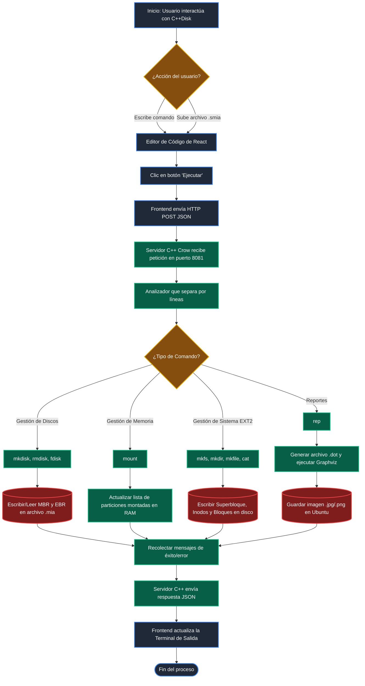

# Manual Técnico: Sistema de Archivos EXT2

**Proyecto 1 - Manejo e Implementación de Archivos**
**Carnet:** 202400044

---

## 1. Arquitectura del Sistema

El sistema "C++Disk" está diseñado bajo una arquitectura de modelo **Cliente-Servidor**, dividiendo las responsabilidades lógicas y visuales en dos capas independientes que se comunican a través de una API REST.

### Capa Frontend (Cliente)

Desarrollada en **React** utilizando **TailwindCSS** para el diseño de la interfaz de usuario.

* **Propósito:** Proveer un entorno de trabajo visual interactivo (IDE minimalista) donde el usuario puede escribir scripts multilínea, subir archivos `.smia` y visualizar la consola de salida.
* **Comunicación:** Utiliza la API nativa `fetch` de JavaScript para enviar peticiones HTTP POST asíncronas con formato JSON al servidor.

### Capa Backend (Servidor)

Desarrollada en **C++17** utilizando el micro-framework web **Crow**.

* **Propósito:** Actuar como el motor lógico del sistema. Recibe los scripts, realiza el análisis léxico/sintáctico, ejecuta las operaciones a nivel de bytes en archivos binarios (simulando discos duros) y devuelve los resultados.
* **Manejo de CORS:** Implementa el middleware `crow::CORSHandler` para permitir peticiones transversales desde el puerto de React (5173) hacia el puerto de C++ (8081).
* **Estructura de ejecución:** Un analizador divide el script línea por línea, ignora los comentarios (`#`), identifica el comando principal, parsea sus parámetros (ej. `-size`, `-path`) y redirige el flujo a las funciones de manejo binario.

---

## 2. Explicación de las Estructuras Implementadas

Para la simulación del almacenamiento, el sistema utiliza estructuras serializables (`structs`) que se escriben directamente en archivos `.mia` binarios.

### 2.1 Estructuras de Particionamiento

Definen la distribución lógica del disco físico.

* **MBR (Master Boot Record):** Se ubica al inicio del archivo (byte 0). Ocupa una cantidad fija de memoria y controla hasta 4 particiones primarias/extendidas.
* `mbr_size` (int): Tamaño total del disco.
* `mbr_fecha_creacion` (time_t): Fecha y hora de creación.
* `mbr_dsk_signature` (int): Número aleatorio único del disco.
* `mbr_partitions[4]` (Partition): Arreglo con la información de las 4 particiones principales.


* **Partition:** Contiene el estado (`1` activa, `0` inactiva), tipo (`P` primaria, `E` extendida), ajuste (`BF`, `FF`, `WF`), byte de inicio (`part_start`), tamaño (`part_size`) y el nombre de la partición (16 chars).
* **EBR (Extended Boot Record):** Estructuras enlazadas que se guardan al inicio de cada partición Lógica dentro de una Extendida. Mantienen un apuntador `part_next` hacia el byte de inicio del siguiente EBR.

### 2.2 Estructuras del Sistema de Archivos (EXT2)

Se inicializan al ejecutar el comando `mkfs` dentro de una partición previamente montada.

* **Superbloque (Superblock):** Describe el estado global del sistema de archivos. Administra los conteos de inodos y bloques, así como las direcciones lógicas donde inician los Bitmaps y las tablas de datos. Su *magic number* es `0xEF53`.
* **Inodo (Inode):** Representa un archivo o carpeta. Contiene metadatos cruciales y administra los permisos a nivel del sistema operativo.
* `i_uid` / `i_gid` (int): Identificadores del propietario y grupo.
* `i_size` (int): Tamaño en bytes.
* `i_atime`, `i_ctime`, `i_mtime` (time_t): Fechas de lectura, creación y modificación.
* `i_block[15]` (int): Arreglo de 15 apuntadores (12 directos, 1 simple indirecto, 1 doble, 1 triple).
* `i_type` (char): '0' si es carpeta, '1' si es archivo.
* `i_perm` (int): Permisos estándar (ej. 664).


### 2.3 Estructuras de Bloques

Los bloques son la unidad mínima de almacenamiento útil (64 bytes cada uno).

* **Bloque de Carpeta (FolderBlock):** Almacena 4 registros de tipo `Content`, cada uno con un nombre de archivo/carpeta (`b_name` de 12 bytes) y el apuntador lógico a su inodo correspondiente (`b_inodo`). Los dos primeros apuntadores suelen ser `.` (inodo actual) y `..` (inodo padre).
* **Bloque de Archivo (FileBlock):** Contiene un arreglo estricto de 64 caracteres (`b_content[64]`) para almacenar la información en texto plano o contenido crudo.
* **Bloque de Apuntadores (PointerBlock):** Contiene un arreglo de 16 enteros. Se utiliza para expandir la capacidad de direccionamiento de un inodo cuando los 12 bloques directos se llenan.

---

## 3. Ejemplos de Uso de Comandos

El analizador soporta ejecución secuencial de instrucciones. Todos los parámetros son insensibles a mayúsculas y minúsculas (a excepción de rutas y nombres específicos).

### Administración de Discos

```bash
# Crear un disco de 50MB con ajuste Primer Ajuste
mkdisk -size=50 -unit=M -fit=FF -path=/home/pablo/Calificacion_MIA/Discos/Disco1.mia

# Borrar un disco existente
rmdisk -path=/home/pablo/Calificacion_MIA/Discos/Disco1.mia

# Crear partición primaria de 10MB
fdisk -type=P -unit=M -name=Part1 -size=10 -path=/home/pablo/Calificacion_MIA/Discos/Disco1.mia -fit=BF

# Montar partición (El sistema genera el ID de montaje automáticamente, ej. 441A)
mount -path=/home/pablo/Calificacion_MIA/Discos/Disco1.mia -name=Part1

```

### Formateo y Sesiones

```bash
# Formatear la partición montada con sistema EXT2
mkfs -type=full -id=441A

# Iniciar sesión con el usuario administrador (creado por defecto en el mkfs)
login -user=root -pass=123 -id=441A

# Cerrar la sesión actual
logout

```

### Administración del Sistema de Archivos

```bash
# Crear una nueva carpeta (y sus carpetas padres si no existen usando -p)
mkdir -p -path=/home/archivos/user/docs/usac

# Crear un archivo de 75 bytes de tamaño
mkfile -path=/home/archivos/user/docs/Tarea.txt -size=75

# Crear un archivo extrayendo el texto desde la computadora real
mkfile -path=/home/archivos/user/docs/Tarea3.txt -size=10 -cont=/home/pablo/Desktop/NAME.txt

# Leer e imprimir el contenido de uno o varios archivos en la consola
cat -file1=/home/archivos/user/docs/Tarea2.txt

```

### Generación de Reportes (Graphviz)

```bash
# Reporte lógico de inodos y bloques (Árbol completo del sistema)
rep -id=441A -path=/home/pablo/Calificacion_MIA/Reportes/p4_r8_tree.png -name=tree

# Reporte visual de las particiones y espacio libre del disco
rep -id=441A -Path=/home/pablo/Calificacion_MIA/Reportes/p1_r1_disk.jpg -name=disk

# Reporte en texto plano del Superbloque
rep -id=441A -path=/home/pablo/Calificacion_MIA/Reportes/p4_r5_sb.txt -name=sb

```

* **Estructura de ejecución:** Un analizador divide el script línea por línea, ignora los comentarios (`#`), identifica el comando principal, parsea sus parámetros (ej. `-size`, `-path`) y redirige el flujo a las funciones de manejo binario.


## 4. Diagrama de flujo de la aplicacion



