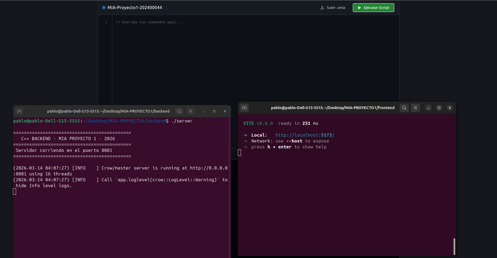
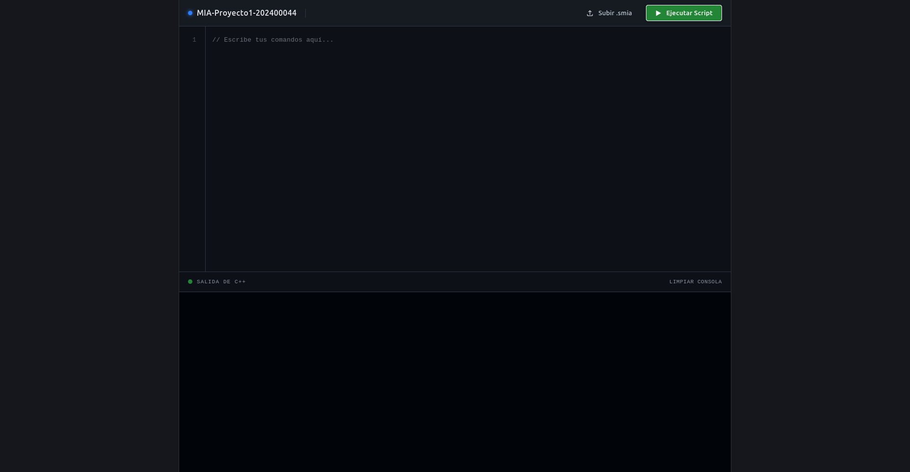
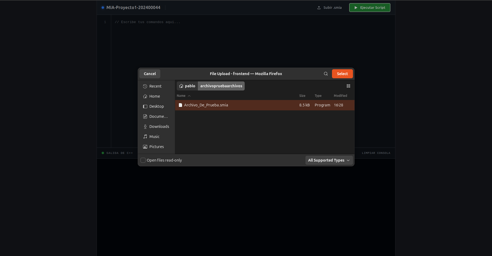
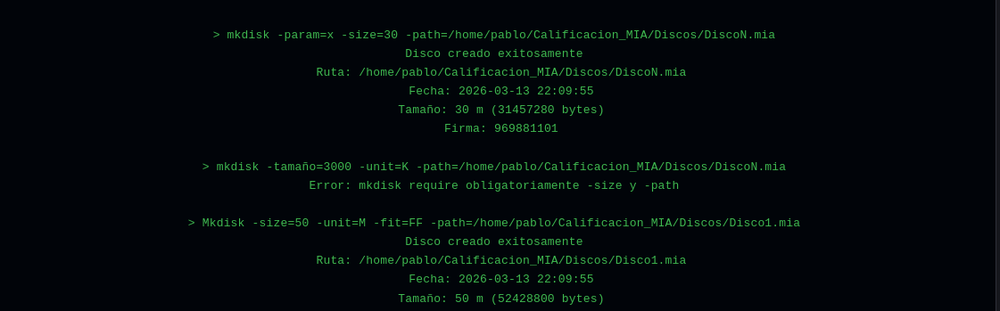
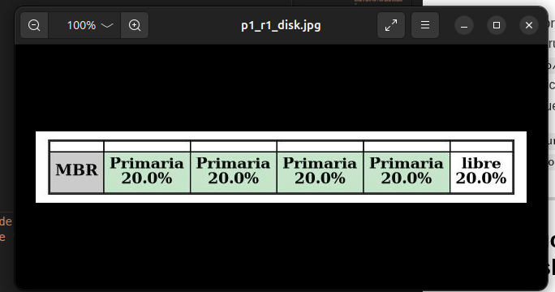

# Manual de Usuario: Interfaz C++Disk

**Proyecto 1 - Manejo e Implementación de Archivos**
**Desarrollador:** Pablo Solares
**Carnet:** 202400044

---

## 1. Introducción al Sistema

C++Disk es una plataforma web  diseñada para facilitar la interacción con el sistema de archivos EXT2. La interfaz, construida con React y Tailwind CSS, simula un entorno de desarrollo profesional (IDE) de alto contraste (Dark Mode) que protege la vista del usuario y permite enviar comandos masivos al servidor C++ con un solo clic.

---

## 2. Requisitos Previos e Inicio del Sistema

Para que el entorno funcione correctamente, se deben levantar tanto el servidor lógico como la interfaz gráfica.

**Paso 1: Iniciar el Backend (C++)**

1. Abre una terminal en Ubuntu y dirígete a la carpeta del backend.
2. Compila el código ejecutando: `g++ -std=c++17 -pthread server.cpp -o server -lboost_system`
3. Inicia el servidor ejecutando: `./server`
4. La terminal mostrará el mensaje: `Servidor corriendo en el puerto 8081`.

**Paso 2: Iniciar el Frontend (React)**

1. Abre una segunda terminal y dirígete a la carpeta del frontend.
2. Ejecuta el comando: `npm run dev`
3. Abre tu navegador web y entra a la dirección `http://localhost:5173/`.

---

## 3. Entorno de Trabajo (Interfaz Gráfica)

La pantalla principal se divide estratégicamente en tres áreas principales para maximizar el espacio de trabajo:

1. **Barra de Controles (Superior):** Muestra el estado del proyecto, el nombre del archivo actual y contiene los botones de acción principal ("Subir Script" y "Ejecutar").
2. **Editor de Código (Centro):** Un área de texto enriquecida con numeración de líneas automáticas y tabulación inteligente. Aquí es donde se escriben o cargan los comandos.
3. **Terminal de Salida (Inferior):** Consola dedicada que muestra la respuesta en tiempo real del servidor C++ en formato de texto verde retro. Cuenta con un botón para limpiar el historial.

---

## 4. Uso del Sistema (Pasos Detallados)

### 4.1 Escribir comandos manualmente

Si deseas ejecutar comandos rápidos (como crear un disco o iniciar sesión), simplemente haz clic en el **Editor de Código** central y comienza a escribir.

* Puedes usar la tecla `TAB` para indentar visualmente tus comandos.
* Los números de línea se ajustarán automáticamente al dar `Enter`.

### 4.2 Subir un Script `.smia` completo

Para la calificación del proyecto o ejecución masiva de instrucciones:

1. Haz clic en el texto **"Subir Script"** (junto al ícono de la carpeta) en la barra superior derecha.
2. Se abrirá el explorador de archivos de Ubuntu. Selecciona tu archivo de calificación (ej. `calificacion.smia` o `prueba.txt`).
3. El contenido del archivo se vaciará instantáneamente en el editor de código, y el indicador superior actualizará el nombre del archivo.

### 4.3 Ejecutar el Script

Una vez que el código esté en el editor:

1. Haz clic en el botón azul **"Ejecutar"** en la esquina superior derecha.
2. En la terminal inferior aparecerá el mensaje: `Ejecutando en C++...`
3. El frontend enviará el bloque completo de código al backend. Espera unos segundos mientras el C++ simula los discos y genera los reportes Graphviz.
4. Al finalizar, la **Terminal de Salida** imprimirá el registro detallado de cada comando procesado, marcando errores de sintaxis, advertencias de permisos o éxitos de creación.

---

## 5. Visualización de Reportes

Todos los reportes generados por el comando `rep` (como `tree`, `disk`, `ls`, `sb`) son creados y procesados por Graphviz directamente en el sistema de archivos de Ubuntu.

Para visualizarlos:

1. Abre el explorador de archivos nativo de tu distribución de Linux.
2. Dirígete a la ruta absoluta especificada en tu comando (ejemplo: `/home/pablo/Calificacion_MIA/Reportes/`).
3. Haz doble clic en el archivo `.jpg`, `.png` o `.pdf` para ver las estructuras gráficas de tus inodos, bloques y particiones.

---

## 6. Resolución de Problemas Comunes (Troubleshooting)

A continuación, se presentan los errores más frecuentes al utilizar la plataforma y sus soluciones:

* **Error: "NetworkError when attempting to fetch resource" o "Error de red" en la consola de React.**
* *Causa:* El servidor C++ no está corriendo o está en un puerto diferente.
* *Solución:* Revisa tu terminal de Ubuntu. Asegúrate de haber ejecutado `./server` y que indique que el puerto 8081 está en uso. Si el servidor se detuvo, detenlo con `Ctrl+C` y vuélvelo a arrancar.

* **Problema: La terminal de C++ marca "Error: no se pudo crear el archivo .dot".**
* *Causa:* Graphviz no tiene permisos para escribir en la ruta especificada, o la ruta tiene caracteres especiales inválidos.
* *Solución:* Verifica que la ruta del `-path` en tu comando `rep` tenga el formato correcto y que las carpetas intermedias existan o hayan sido creadas recursivamente por el sistema.

